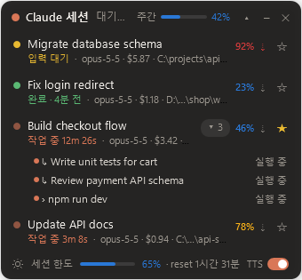
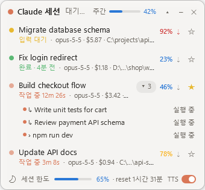

[English](README.md) | **한국어** | [소개 페이지](https://jsuk10.github.io/claude-overlay/ko/)

# Claude Code 세션 오버레이 (Windows)

지금 돌고 있는 **Claude Code** 세션을 한눈에 보여 주는, 항상 위에 떠 있는 Windows 오버레이입니다. CLI 세션과 Claude 데스크톱 앱의 Code 탭 세션을 모두 보여 줍니다. 어떤 세션이 작업 중이고 어떤 세션이 내 입력을 기다리는지, 컨텍스트가 얼마나 찼는지, 주간·5시간 세션 한도가 얼마나 남았는지 보이고, 누르면 그 세션으로 바로 갑니다.

<p align="center">
  
  
</p>

> Anthropic과 관련이 없거나 Anthropic이 보증하지 않는 개인 프로젝트입니다. "Claude"와 "Claude Code"는 Anthropic의 상표입니다.

## 기능

- **세션 현황**: 작업 중, 입력 대기(권한 확인·질문), 끝났는데 아직 확인하지 않은 세션을 보여 줍니다. 이미 확인한 세션은 숨기고, ★ 즐겨찾기는 항상 보입니다.
- **눌러서 이동**: 그 세션을 앞으로 가져옵니다. 데스크톱 앱에서 분할 화면에 이미 떠 있는 세션이면, 첫 번째 화면을 바꾸지 않고 그 화면의 입력창으로 포커스를 옮깁니다.
- **컨텍스트**: 세션마다 `46%`처럼 보입니다. **자동 압축 기준**(100%가 되면 압축)으로 잰 값이고, 색은 데스크톱 앱 사용량 표시와 같습니다: 75% 미만 파랑, 90% 미만 노랑, 그 이상 빨강.
- **사용량 한도**: 머리 줄에 주간 사용량, 맨 아래 줄에 5시간 세션 한도.
- **백그라운드 작업**: 백그라운드 서브에이전트, 백그라운드 셸, 파생 세션을 상위 세션 아래 `▸ 3` 칩에 접어 두고, 누르면 펼칩니다.
- **알림**: 세션이 끝나거나, 입력을 기다리기 시작하거나, 컨텍스트가 90%를 넘으면 짧은 소리와 음성(Windows 기본 TTS)으로 알립니다. 화면 잠금·절전·모니터 꺼짐 중에는 울리지 않습니다.
- **방해하지 않기**: 게임 같은 전체 화면 앱이 앞에 있으면 숨고, 트레이로 최소화하거나 머리 줄만 남기고 접을 수 있습니다. 위치를 기억하고, Windows 시작 시 실행할 수 있습니다.
- **저장소 구분**: 경로를 `드라이브\…\마지막 두 폴더`로 줄여 보여 줘서, 같은 저장소를 C:와 D:에 둬도 구분됩니다.
- **다크/라이트 테마, 한국어/영어 화면**: 맨 아래 버튼으로 테마를 바꾸고, 머리 줄 오른쪽 클릭 메뉴에서 테마와 언어를 고릅니다.

## 설치

Windows 10 또는 11과 Claude Code(CLI) 또는 Claude 데스크톱 앱이 필요합니다.

1. [최신 릴리스](https://github.com/jsuk10/claude-overlay/releases/latest)에서 `ClaudeSessionOverlay-v*-win-x64.zip`을 받습니다.
2. 아무 곳에나 압축을 풀고 `ClaudeSessionOverlay.exe`를 실행합니다. .NET을 따로 설치할 필요가 없습니다.
3. 선택: 트레이 아이콘 메뉴에서 **Windows 시작 시 실행**을 켭니다.

서명되지 않은 앱이라 처음 실행할 때 Windows SmartScreen 경고가 뜰 수 있습니다. **추가 정보 → 실행**을 누르면 됩니다.

### 소스에서 빌드

[.NET 9 SDK](https://dotnet.microsoft.com/download/dotnet/9.0)가 필요합니다.

```powershell
git clone https://github.com/jsuk10/claude-overlay.git
cd claude-overlay
dotnet publish app -c Release -o bin
.\bin\ClaudeSessionOverlay.exe
```

## macOS (미리보기)

`avalonia/`에 여러 OS에서 도는 오버레이(Avalonia UI, .NET 9)가 있고, Windows WPF 앱과 `core/`를 함께 씁니다. 같은 목록을 보여 주고 메뉴 막대 앱으로 돕니다. `osx-arm64`·`osx-x64`로 빌드까지는 확인했지만 **실제 Mac에서는 아직 시험하지 않았습니다**.

필요한 것: macOS 11 이상, [.NET 9 SDK](https://dotnet.microsoft.com/download/dotnet/9.0).

```bash
git clone https://github.com/jsuk10/claude-overlay.git
cd claude-overlay
./scripts/make-macos-app.sh          # Intel Mac: ./scripts/make-macos-app.sh osx-x64
open "out/Claude Session Overlay.app"
```

스크립트가 자체 포함 빌드를 만들어 `.app`(Dock 아이콘 없는 메뉴 막대 앱)으로 묶고 임시 서명합니다. 매번 켜려면 메뉴 막대 아이콘에서 **로그인 시 열기**를 켭니다.

Windows와 다른 점: 데스크톱 앱 세션은 늘 `claude://` 딥 링크로 엽니다(분할 화면 포커스 없음). 터미널 세션은 그 앱(Terminal, iTerm, VS Code …)을 앞으로 가져오지만 정확한 탭까지는 못 갑니다. 음성 알림은 `say`를 씁니다. 오버레이는 모든 Space에 보이지만 전체 화면 앱 위에는 뜨지 않습니다. 데스크톱 앱 데이터는 `~/Library/Application Support/Claude/`에서 읽습니다.

## 동작 방식

오버레이는 Claude Code와 Claude 데스크톱 앱이 원래 남기는 **로컬 파일만 읽습니다**. 네트워크 요청을 보내지 않고, 로그인 정보도 건드리지 않습니다.

| 정보 | 출처 |
| --- | --- |
| 세션, 상태(작업 중 / 대기 / 입력 대기) | `~/.claude/sessions/<pid>.json` |
| 모델, 컨텍스트 토큰, 백그라운드 작업 | 대화 기록 `~/.claude/projects/<프로젝트>/<세션>.jsonl` |
| 컨텍스트 창, 자동 압축 기준 | `~/.claude/cache/model-catalog/*.json`, `~/.claude/settings.json`의 `autoCompactWindow` |
| 주간·5시간 사용량 | Claude 데스크톱 앱이 쓰는 `plan-usage-history.json` |
| 제목, 분할 화면 배치 | Claude 데스크톱 앱의 세션 파일과 `claude_desktop_config.json` |

오버레이 설정(확인한 세션, 즐겨찾기, 위치, 테마, 언어)은 `~/.claude/session-hud/`에 저장됩니다.

## 선택: `session-hud` Mod

오버레이는 혼자서 동작합니다. 함께 들어 있는 Claude Code Mod를 설치하면 다음이 더해집니다.

- 세션별 **비용**과 사용량 한도의 **초기화 시각**
- 오버레이의 **압축 버튼**(`⇣`): 그 세션에서 `/compact`를 실행합니다
- Claude Code 프롬프트 위의 한 줄 HUD:

```
opus-5-5  ctx ████▎      42%  67k/160k  ⇣압축  $1.23        주간 ██▌      31%  ☆
```

새로 시작하는 모든 세션에 로드하려면 `~/.claude/settings.json`에서 `CLAUDE_CODE_PLUGIN_DIRS`가 Mod 폴더를 가리키게 합니다.

```json
{
  "env": { "CLAUDE_CODE_PLUGIN_DIRS": "C:\\path\\to\\claude-overlay\\mod\\session-hud" }
}
```

## 사용 팁

- **세션 오른쪽 클릭**: 열기, 확인 처리, 즐겨찾기, 폴더 열기
- **머리 줄 오른쪽 클릭**: 테마, 언어, 접기, 확인한 세션 다시 보기, 트레이로 숨기기
- **트레이 아이콘**: 왼쪽 클릭으로 보이기/숨기기. 메뉴에 소리·음성 켜고 끄기, 알림 들어보기, 위치 초기화, Windows 시작 시 실행이 있습니다.
- `ClaudeSessionOverlay.exe --demo`는 지어낸 세션으로 오버레이를 띄웁니다(`--theme light`, `--lang ko`).
- `ClaudeSessionOverlay.exe --dump`는 지금 오버레이가 보는 내용을 `~/.claude/session-hud/dump.txt`에 남깁니다.

## 폴더 구성

| 폴더 | 내용 |
| --- | --- |
| `app/` | Windows 오버레이(C#, WPF, .NET 9) |
| `core/` | 세션 파일 읽기·목록 계산 공용 부분(화면 없음) |
| `avalonia/` | macOS용 여러 OS 오버레이(Avalonia, .NET 9) |
| `scripts/` | `make-macos-app.sh`: macOS `.app` 만들기 |
| `mod/session-hud/` | 선택 사항인 Claude Code Mod(TypeScript) |
| `docs/` | 스크린샷과 [소개 페이지](https://jsuk10.github.io/claude-overlay/ko/) |

## 라이선스

[MIT](LICENSE)
