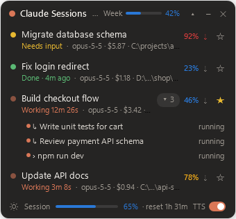
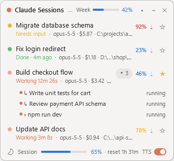
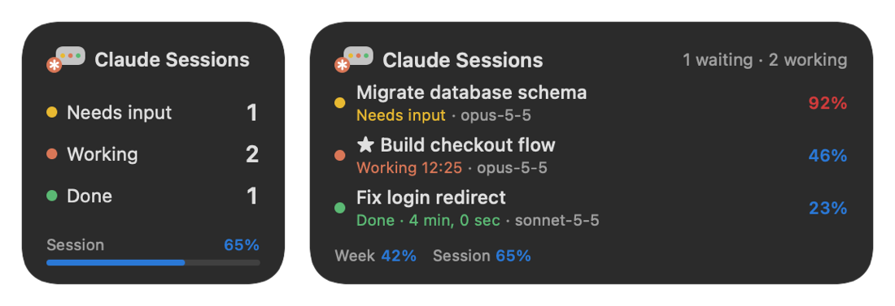

**English** | [한국어](README.ko.md) | [Website](https://claude-overlay.jsuk.cloud/)

# Claude Code Session Overlay for Windows and macOS

An always-on-top overlay for Windows and macOS that shows every running **Claude Code** session at a glance — CLI and the Claude desktop app's Code tab alike. See which sessions are working, which need your input, how full each context window is, and how much of your weekly and 5-hour session limits you have left. Click a session to jump straight to it.

<p align="center">
  
  
</p>

> Not affiliated with or endorsed by Anthropic. "Claude" and "Claude Code" are trademarks of Anthropic.

## Features

- **Live session list** — working, waiting for input (permission prompts, questions) and finished-but-unseen sessions. Sessions you have already looked at are hidden; ★ favorites always stay.
- **Click to jump** — brings the session to the front. For desktop-app sessions shown in split view, focus moves to that pane's prompt box instead of replacing the first pane.
- **Context at a glance** — `46%` next to each session, measured against the **auto-compact threshold** (100% = compaction happens), colored like the Claude desktop usage meter: blue < 75%, yellow < 90%, red ≥ 90%.
- **Usage limits** — weekly usage in the header and the 5-hour session limit in the footer.
- **Background tasks** — background subagents, background shells and side sessions are folded under their parent session (`▸ 3`), click to expand.
- **Alerts** — a chime plus a short voice alert (Windows built-in TTS) when a session finishes, needs input, or its context passes 90%. Muted while the screen is locked, the PC is asleep or the display is off.
- **Stays out of the way** — hides itself when a fullscreen app or game is in front, minimizes to the tray, collapses to a single header line, remembers its position, and can start with Windows.
- **Tells repos apart** — the path is shortened to `drive\…\last two folders`, so the same repo cloned on `C:` and `D:` is easy to tell apart.
- **Dark / light theme and Korean / English UI** — toggle the theme in the footer; pick theme and language from the header's right-click menu.

## Install

Requires Windows 10 or 11 and Claude Code (CLI) and/or the Claude desktop app.

1. Download [`ClaudeSessionOverlay.exe`](https://github.com/jsuk10/claude-overlay/releases/latest/download/ClaudeSessionOverlay.exe) and run it. It is a single file with no .NET install needed; put it anywhere you like.
2. On first launch it asks whether to start with Windows. You can change this later with **Start with Windows** in the tray icon's menu.

Windows SmartScreen may warn about an unsigned app the first time; choose **More info → Run anyway**.

To install it instead, get [`ClaudeSessionOverlay-Setup.exe`](https://github.com/jsuk10/claude-overlay/releases/latest/download/ClaudeSessionOverlay-Setup.exe). It installs to `%LOCALAPPDATA%\Programs` without admin rights, adds a Start menu shortcut and lets you pick **Start with Windows** and the [`session-hud` mod](#optional-the-session-hud-mod) during setup; uninstalling removes both. The [release page](https://github.com/jsuk10/claude-overlay/releases/latest) also has a zip with the exe, this README and the optional mod.

### Build from source

Needs the [.NET 9 SDK](https://dotnet.microsoft.com/download/dotnet/9.0).

```powershell
git clone https://github.com/jsuk10/claude-overlay.git
cd claude-overlay
dotnet publish app -c Release -o bin
.\bin\ClaudeSessionOverlay.exe
```

## macOS

Runs as a menu bar app on macOS 11 or later (widgets need macOS 14 or later). The Avalonia overlay in `avalonia/` shares `core/` with the Windows app; the menu bar item and the widgets are a small amount of Swift in `macos/`. Tested on an Apple Silicon Mac (macOS 15). See [macos/README.md](macos/README.md) for how the pieces fit together (in Korean).

### Install

1. Download `ClaudeSessionOverlay-macos-arm64.dmg` (Apple Silicon) or `ClaudeSessionOverlay-macos-x64.dmg` (Intel) from the [latest release](https://github.com/jsuk10/claude-overlay/releases/latest).
2. Open it, drag **Claude Session Overlay** into **Applications** and launch it. A ✻ icon appears in the menu bar, and on first launch it asks whether to open at login (change it later with **Open at login** in its menu).
3. The app is not notarized yet, so macOS warns on first launch. Go to **System Settings → Privacy & Security → Open Anyway**.

Or install from Terminal in one line, which skips the warning and launches the app:

```bash
curl -fsSL https://claude-overlay.jsuk.cloud/install.sh | bash
```

### Menu bar and widgets

- **Menu bar**: next to ✻, colored counts of sessions that need input (yellow), are working (orange) or are done (green), plus the 5-hour limit once it passes 75%. Click it for the session list (pick one to jump to it), weekly and 5-hour usage, and the overlay's commands (show/hide, alerts, open at login, quit).
- **Widgets**: put them in Notification Center (click the date and time in the menu bar) or on the desktop: right-click the desktop → **Edit Widgets** → "Claude Session Overlay". Small (counts and the 5-hour limit), medium (three sessions), large (seven sessions and usage bars) or extra large for the desktop (counts, usage, and seven sessions with folders). Click a session to jump to it.
- **Control Center** (macOS 26 and later): add the "Claude 세션" control to Control Center or the menu bar to see how many sessions need input; clicking it opens that session (or the overlay). Add it from Control Center → **Edit Controls**.
- Widgets read `~/.claude/session-hud/status.json`, which the overlay writes. If the overlay isn't running, they switch to "The overlay isn't running" after a few minutes.

<p align="center"></p>

### Build from source

Needs the [.NET 9 SDK](https://dotnet.microsoft.com/download/dotnet/9.0) and Xcode or the Command Line Tools (`xcode-select --install`).

```bash
git clone https://github.com/jsuk10/claude-overlay.git
cd claude-overlay
./scripts/make-macos-app.sh          # Intel Mac: ./scripts/make-macos-app.sh osx-x64
open "out/Claude Session Overlay.app"
```

The script builds the Swift parts (menu bar library and widget) as universal binaries, wraps them with a self-contained .NET build in a `.app` (menu bar only, no Dock icon), signs it and writes `out/ClaudeSessionOverlay-macos-<arm64|x64>.dmg`. It ad-hoc signs by default; set `SIGN_IDENTITY` to a Developer ID certificate name to sign with it and the hardened runtime. Pushing a `v*` tag makes GitHub Actions ([release.yml](.github/workflows/release.yml)) build the Windows installer, zip and exe and both DMGs and attach them to that release.

Differences from Windows: clicking a desktop-app session always opens it with the `claude://` deep link (no split-view pane focus); clicking a terminal session selects its exact tab in Terminal or iTerm2 (macOS asks once for automation permission) and otherwise brings its app (VS Code …) to the front; voice alerts use `say` with a natural voice for the UI language (novelty and low-quality voices are skipped); the overlay appears on every Space but not over fullscreen apps. Desktop-app data is read from `~/Library/Application Support/Claude/`.

## How it works

The overlay only **reads local files** that Claude Code and the Claude desktop app already write. It makes no network requests and never touches your credentials.

| Data | Source |
| --- | --- |
| Sessions, status (working / idle / waiting for input) | `~/.claude/sessions/<pid>.json` |
| Model, context tokens, background tasks | Session transcripts `~/.claude/projects/<project>/<session>.jsonl` |
| Context window, auto-compact threshold | `~/.claude/cache/model-catalog/*.json`, `autoCompactWindow` in `~/.claude/settings.json` |
| Weekly and 5-hour usage | `plan-usage-history.json` written by the Claude desktop app |
| Titles, split-view layout | Claude desktop app session files and `claude_desktop_config.json` |

Overlay settings (seen sessions, favorites, position, theme, language) are stored in `~/.claude/session-hud/`.

## Optional: the `session-hud` mod

The overlay works on its own. Installing the bundled Claude Code mod adds:

- **Cost** per session and the **reset time** of the usage limits
- A **compact button** (`⇣`) in the overlay that runs `/compact` in that session
- A one-line HUD above the prompt inside Claude Code (its labels are currently Korean: `압축` = compact, `주간` = week):

```
opus-5-5  ctx ████▎      42%  67k/160k  ⇣압축  $1.23        주간 ██▌      31%  ☆
```

The Windows installer does this for you when you tick **Add the session-hud mod to Claude Code**; if another `session-hud` folder is already listed, it is replaced with the installed one. It loads in Claude Code sessions started after that.

To do it by hand, load it in every new session by pointing `CLAUDE_CODE_PLUGIN_DIRS` at the mod folder in `~/.claude/settings.json`:

```json
{
  "env": { "CLAUDE_CODE_PLUGIN_DIRS": "C:\\path\\to\\claude-overlay\\mod\\session-hud" }
}
```

## Usage tips

- **Right-click a session** — open, mark as seen, favorite, open folder.
- **Right-click the header** — theme, language, collapse, show seen sessions again, hide to tray.
- **Tray icon** — left-click shows/hides the overlay; the menu has sound/voice toggles, a test alert, reset position and start with Windows.
- `ClaudeSessionOverlay.exe --demo` shows the overlay with made-up sessions (`--theme light`, `--lang ko`).
- `ClaudeSessionOverlay.exe --dump` writes what the overlay currently sees to `~/.claude/session-hud/dump.txt`.

## Project layout

| Folder | Contents |
| --- | --- |
| `app/` | The Windows overlay (C#, WPF, .NET 9) |
| `core/` | Shared session reading and list logic (no UI) |
| `avalonia/` | Cross-platform overlay for macOS (Avalonia, .NET 9) |
| `macos/` | macOS menu bar item and widgets (Swift) |
| `scripts/` | `make-macos-app.sh`: builds the macOS `.app` and `.dmg` |
| `mod/session-hud/` | The optional Claude Code mod (TypeScript) |
| `docs/` | Screenshots and the [project website](https://claude-overlay.jsuk.cloud/) |

## License

[MIT](LICENSE)
